# Labs64.IO :: Helm Charts

**Kubernetes charts for every Labs64.IO module, and the installer that puts them to work.**
*Part of the [Labs64.IO Ecosystem](https://labs64.io): how the whole platform, or a single module, gets onto a cluster.*

[](https://github.com/Labs64/labs64.io-helm-charts/actions/workflows/labs64io-lint-charts.yml)
[](https://artifacthub.io/packages/search?repo=labs64io-helm-charts)
[](LICENSE)
[](https://labs64.io/docs/getting-started/deploy-to-kubernetes/)

<p align="center"></p>

[**Get started**](#get-started) · [Features](#features) · [Architecture](#architecture) · [AI agents](#using-helm-charts-with-ai-agents) · [Ecosystem](#the-labs64io-ecosystem) · [Documentation](https://labs64.io/docs/getting-started/deploy-to-kubernetes/) · [labs64.io](https://labs64.io)

> [!NOTE]
> `install.sh` is for evaluation: its Quickstart profile ships a demo identity provider that issues a token to anyone. For anything reachable by other people, install with your own identity provider and follow the go-live checks.

## Why Helm Charts?

Running a platform of several services means one chart per service, gateway wiring, an identity provider and a handful of backing stores. Helm Charts packages that so you can start small and grow:

1. **One command to see it work.** `install.sh` installs the platform on any cluster and proves it with a real request.
2. **Cherry-pick modules.** Every module chart is standalone: install only what you need, and bring your own infrastructure.
3. **A path to production.** The same charts run on AWS, Azure, Google Cloud or on-premises, with a `preflight` chart to check your infrastructure first.

## Get started

Four ways in. Pick the one that matches what you have; each is complete on its own.

```
 1  install.sh             2  Kubernetes             3  Docker                 4  Source
┌───────────────────────┐ ┌───────────────────────┐ ┌───────────────────────┐ ┌───────────────────────┐
│ The whole ecosystem   │ │ The umbrella chart    │ │ A local k3d cluster   │ │ Lint and template     │
│ with gateway + auth   │ │ or any module chart   │ │ (Kubernetes inside    │ │ the charts, change    │
│ and a live smoke      │ │ on your cluster and   │ │ Docker), then the     │ │ them, contribute      │
│ test                  │ │ your infrastructure   │ │ same installer        │ │ back                  │
├───────────────────────┤ ├───────────────────────┤ ├───────────────────────┤ ├───────────────────────┤
│ needs  a cluster,     │ │ needs  a cluster,     │ │ needs  Docker, k3d,   │ │ needs  Helm 4, Git    │
│        kubectl, helm  │ │        kubectl, helm  │ │        kubectl, helm  │ │                       │
│ time   ~5 minutes     │ │ time   an afternoon   │ │ time   ~5 minutes     │ │ time   a few minutes  │
└───────────────────────┘ └───────────────────────┘ └───────────────────────┘ └───────────────────────┘
 evaluate everything       run it for real           try it locally            work on the charts
```

Not sure? Start with **3** if you have no cluster, or **1** if you do.

### 1. `install.sh`: the quick ecosystem start

`install.sh` lives in this repository. It installs the gateway, authentication, AuditFlow and Payment Gateway on any Kubernetes cluster, then proves it with a real request. No cluster? A throwaway one on your laptop is enough:

```bash
k3d cluster create labs64io-demo -p "8000:80@loadbalancer" --k3s-arg "--disable=traefik@server:0"   # optional

curl -fsSL https://raw.githubusercontent.com/Labs64/labs64.io-helm-charts/master/install.sh -o install.sh
bash install.sh
```

Press Enter three times to take the defaults. You finish with a gateway you can `curl`, interactive API docs and a working token flow:

```text
  PASS  Obtained a demo access token from mock-oidc
  PASS  Published a demo audit event (HTTP 200) — first good request succeeded

 Labs64.IO is ready.
   Base URL:  http://localhost:8000
   API docs:  http://localhost:8000/swagger-ui/
```

Non-interactive installs: `LABS64_PROFILE=quickstart bash install.sh` (everything bundled, demo identity provider) or `LABS64_PROFILE=byo LABS64_OIDC_DISCOVERY_URL=<url> bash install.sh` (your own issuer). The same script later runs `status`, `stop`, `start` and `uninstall`. This is an evaluation install with a demo identity provider: keep it on a local or private cluster. Details: [Quickstart](https://labs64.io/docs/getting-started/quickstart/) · [`install.sh`](https://github.com/Labs64/labs64.io-helm-charts/blob/master/install.sh).

### 2. Kubernetes: on your own cluster

Install the umbrella chart, or any module chart on its own:

```bash
helm repo add labs64io https://labs64.github.io/labs64.io-helm-charts
helm repo update

helm install my-auditflow labs64io/auditflow -n labs64io --create-namespace     # one module
helm install labs64io labs64io/labs64io-ecosystem -n labs64io --create-namespace  # the platform
```

Each module declares the infrastructure it needs (RabbitMQ, PostgreSQL, Redis); the `preflight` chart checks them from inside your cluster before you install. Guides: [Deploy to your Kubernetes cluster](https://labs64.io/docs/getting-started/deploy-to-kubernetes/) · [Helm repository on Artifact Hub](https://artifacthub.io/packages/search?repo=labs64io-helm-charts).

### 3. Docker: a local cluster on your machine

k3d runs Kubernetes inside Docker, so Docker is all the cluster needs:

```bash
k3d cluster create labs64io-demo -p "8000:80@loadbalancer" --k3s-arg "--disable=traefik@server:0"
LABS64_PROFILE=quickstart bash install.sh
```

The gateway is published on <http://localhost:8000>. Remove everything with `bash install.sh uninstall` and `k3d cluster delete labs64io-demo`.

### 4. Source: build and change it

Needs Helm 4 and Git. To work on charts against a local cluster built from source, use the [Workspace](https://github.com/Labs64/labs64.io-workspace) or [`DEVELOPERS.md`](DEVELOPERS.md):

```bash
git clone https://github.com/Labs64/labs64.io-helm-charts.git && cd labs64.io-helm-charts
helm dependency build charts/auditflow
helm lint charts/auditflow
helm template my-auditflow charts/auditflow | less
```

[`AGENTS.md`](AGENTS.md) describes the layout, the per-module `overrides/` and the release flow; the [Contributing guide](https://labs64.io/docs/development/contributing/) covers the workflow.

### Where next?

Everything below is in the [Helm Charts documentation](https://labs64.io/docs/getting-started/deploy-to-kubernetes/):

| I want to… | Read |
|---|---|
| Follow the first request step by step | [Quickstart](https://labs64.io/docs/getting-started/quickstart/) |
| Install on AWS, Azure, Google Cloud or on-premises | [Deploy to your Kubernetes cluster](https://labs64.io/docs/getting-started/deploy-to-kubernetes/) |
| Check my infrastructure first | [Preflight](https://labs64.io/docs/getting-started/deploy-to-kubernetes/) |
| Read the full chart reference | [`docs/reference.md`](docs/reference.md) |
| Compare all the ways to run Labs64.IO | [Choose a deployment path](https://labs64.io/docs/getting-started/choose-a-deployment-path/) |

## Features

- **`install.sh`**: install, status, start, stop, uninstall and smoke test for the whole platform on any cluster.
- **Umbrella chart**: `labs64io-ecosystem` installs the platform together, with demo and AWS reference profiles.
- **Module charts**: `auditflow`, `payment-gateway`, `checkout`, `customer-portal`, `api-gateway`, `authz-pdp` and `api-docs`, each standalone.
- **Gateway API routing**: modules own their routes; Traefik is the Gateway implementation.
- **Preflight**: a one-shot job that tests your broker, database, Redis and OIDC endpoint from inside the cluster.
- **Bring your own infrastructure**: no application chart bundles RabbitMQ, PostgreSQL or Redis as a dependency.
- **Secrets your way**: plain Kubernetes Secrets, or External Secrets Operator.

## Architecture

```
  ┌──────────────────────────────────────────────────────────────────────┐
  │ install.sh  ·  helm install labs64io/labs64io-ecosystem               │
  └──────────────────────────────────┬───────────────────────────────────┘
                                     │ umbrella chart
        ┌─────────────┬──────────────┼──────────────┬──────────────┐
  ┌─────▼─────┐ ┌─────▼──────┐ ┌─────▼──────┐ ┌─────▼──────┐ ┌─────▼──────┐
  │ api-      │ │ authz-pdp  │ │ auditflow  │ │ payment-   │ │ checkout · │
  │ gateway   │ │ (Cerbos)   │ │            │ │ gateway    │ │ portal     │
  └─────┬─────┘ └────────────┘ └─────┬──────┘ └─────┬──────┘ └────────────┘
        │ Traefik + Gateway API      │ RabbitMQ      │ PostgreSQL · Redis
        ▼                            ▼               ▼
  your identity provider        your infrastructure (or bundled for evaluation)
```

Deployment modes, capability requirements and the AWS reference profile are in [`docs/reference.md`](docs/reference.md).

## Using Helm Charts with AI agents

Helm Charts is how an agent (or a CI job) gets a Labs64.IO environment it can test against.

- **Unattended installs.** `LABS64_PROFILE=quickstart` or `byo` skips every prompt; `bash install.sh status` exits non-zero when something is unhealthy and `smoke` repeats the token and publish check.
- **Everything is labelled.** The installer records what it created, so `uninstall` never touches resources it did not create.
- **Dry run first.** `bash install.sh --dry-run` shows what would change.
- **Working on the charts with an agent?** [`AGENTS.md`](AGENTS.md) and [`CLAUDE.md`](CLAUDE.md) describe the layout, conventions and checks.

## The Labs64.IO Ecosystem

Helm Charts is one module of the [Labs64.IO Ecosystem](https://labs64.io); [every module is documented here](https://labs64.io/docs/).

| Module | What it does | Link |
|---|---|---|
| **AuditFlow** | Audit-event routing pipeline | [labs64.io-auditflow](https://github.com/Labs64/labs64.io-auditflow) |
| **API Gateway** | Authenticating, policy-enforcing edge for all modules | [labs64.io-authproxy](https://github.com/Labs64/labs64.io-authproxy) |
| **Payment Gateway** | One API over multiple payment providers | [labs64.io-payment-gateway](https://github.com/Labs64/labs64.io-payment-gateway) |
| **Checkout** | Embeddable, brandable checkout | [labs64.io-checkout](https://github.com/Labs64/labs64.io-checkout) |
| **Customer Portal** | Customer self-service UI | [labs64.io-customer-portal](https://github.com/Labs64/labs64.io-customer-portal) |
| **Commons** | Shared Java and Python libraries | [labs64.io-commons](https://github.com/Labs64/labs64.io-commons) |
| **Helm Charts** | Kubernetes deployment for every module | [labs64.io-helm-charts](https://github.com/Labs64/labs64.io-helm-charts) |
| **Workspace** | Dev container and multi-repo tooling | [labs64.io-workspace](https://github.com/Labs64/labs64.io-workspace) |
| **Tests** | Cross-module regression suite | [labs64.io-tests](https://github.com/Labs64/labs64.io-tests) |
| **Docs** | Published documentation | [labs64.io-docs](https://github.com/Labs64/labs64.io-docs) |
| **NetLicensing** | Licensing-as-a-Service: license and entitlement management | [netlicensing.io](https://netlicensing.io) |
| **GuideChimp** | Interactive guided product tours | [labs64.com/guidechimp](https://www.labs64.com/guidechimp/) |

## Contributing

Contributions of all sizes are welcome. Fork, branch, run the checks described in [`AGENTS.md`](AGENTS.md), and open a pull request. If you are unsure whether something fits, open an issue first.

## License

The core of the *Labs64.IO Ecosystem* is entirely open source and free forever. Community modules are licensed under [Apache License 2.0](LICENSE).

---

<p align="center">
  <a href="https://labs64.io"></a><br>
  <sub>Made by the <a href="https://labs64.io">Labs64</a> team and community.</sub>
</p>
