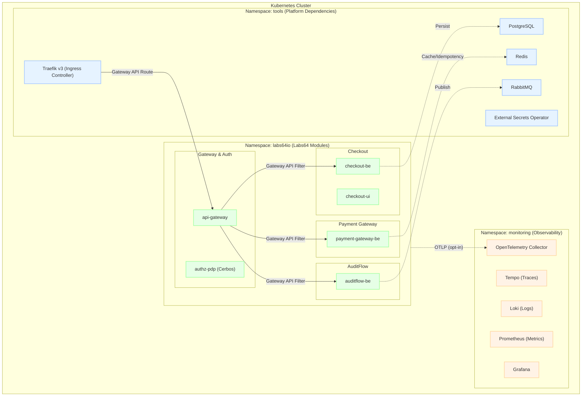
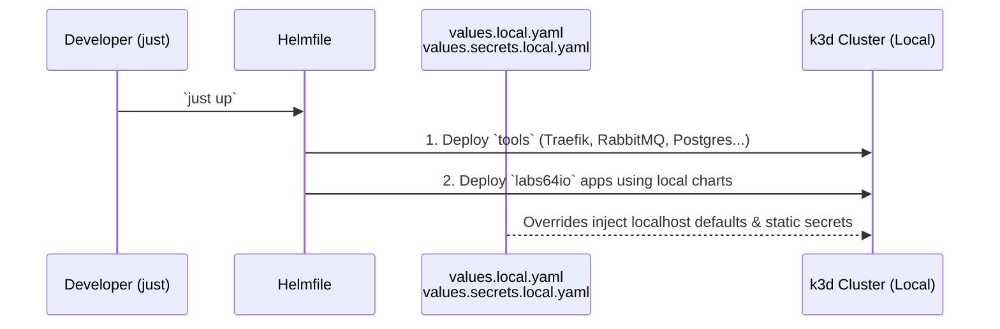
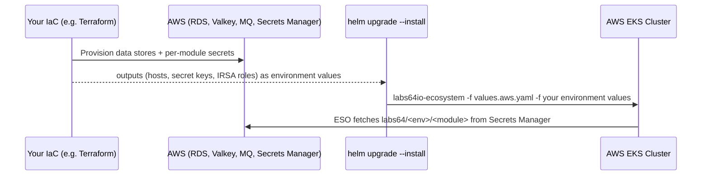

# Helm Charts reference

Long-form reference that used to live in the repository README. The [README](../README.md) is the
short entry point; the published documentation is at [labs64.io/docs](https://labs64.io/docs/).

## Quick start

You need `kubectl`, Helm 4 and a Kubernetes cluster. A local one is enough, and the install takes about five minutes.

```bash
# No cluster yet? Create one with k3d; the gateway is published on http://localhost:8000.
k3d cluster create labs64io-demo -p "8000:80@loadbalancer" --k3s-arg "--disable=traefik@server:0"

curl -fsSL https://raw.githubusercontent.com/Labs64/labs64.io-helm-charts/master/install.sh -o install.sh
bash install.sh        # confirm the cluster, then choose "Install or update" and "Quickstart"
```

The installer applies the Gateway API CRDs if they are missing, installs the latest published `labs64io-ecosystem` chart into the `labs64io` namespace (gateway, Auth Gateway, policy engine, AuditFlow, Payment Gateway, Swagger UI, bundled PostgreSQL, RabbitMQ and Valkey, and a demo identity provider), then requests a token and publishes an audit event through the gateway to prove the install is callable. It prints the commands so you can repeat them.

> The Quickstart profile is for evaluation. Its demo identity provider issues a valid token to anyone, so keep it off clusters that are reachable from outside.

| Command | What it does |
|---|---|
| `bash install.sh` | Menu: install or update, status, start, stop, uninstall, smoke test |
| `LABS64_PROFILE=quickstart bash install.sh` | Install without questions: everything bundled, demo identity provider |
| `LABS64_PROFILE=byo LABS64_OIDC_DISCOVERY_URL=<url> bash install.sh` | Install without questions, with your own OIDC issuer and no demo identity provider |
| `bash install.sh status` | What is installed and whether it is healthy; exits non-zero if not |
| `bash install.sh smoke` | Repeat the token and publish check |
| `bash install.sh stop` / `start` | Scale to zero and back; data and secrets stay |
| `bash install.sh uninstall` | Remove what the installer created; asks before deleting data |
| `bash install.sh --help` | Every setting, including `LABS64_NAMESPACE`, `LABS64_CHART_VERSION` and `LABS64_GATEWAY_URL` |

Generated values, passwords and the transcript of the last run are kept in `./labs64.io-install/`. Running the installer again is safe: it reuses the recorded chart version and the existing passwords.

**Where to go next**

| You want to… | Read |
|---|---|
| Follow the first request step by step | [Quickstart](https://labs64.io/docs/getting-started/quickstart.html) |
| Install on your own cluster: AWS, Azure, Google Cloud, on-premises | [Deploy to your Kubernetes cluster](https://labs64.io/docs/getting-started/deploy-to-kubernetes.html) and [Deployment Modes](#deployment-modes) below |
| Install a single module chart | [Building-Box](#building-box-cherry-pick-your-modules) below |
| Work on the charts with a local cluster built from source | [DEVELOPERS.md](../DEVELOPERS.md) |

## High-Level Architecture Overview

The ecosystem separates resources logically into namespaces. Application workloads (the proprietary Labs64 microservices) reside in `labs64io`, while third-party (3PP) platform dependencies reside in `tools` or `monitoring`.



## Deployment Modes

The Helm charts adapt seamlessly from local environments to robust GitOps-managed clusters and arbitrary user-provided infrastructure. The configuration is isolated in environment overrides (`overrides/<app>/values.<env>.yaml`).

### 1. Local Development (Helmfile + k3d)

The local environment optimizes for speed and developer convenience.

- **Orchestration**: Managed by [Helmfile](https://github.com/helmfile/helmfile) and `just`.
- **Infrastructure**: Spun up locally on `k3d`. Helmfile applies Bitnami charts to the `tools` namespace.
- **Secrets**: `externalSecrets.enabled: false`. Developers populate local `values.secrets.local.yaml` files (git-ignored) which directly render plain Kubernetes `Secret` resources.



### 2. AWS QA / Staging / Prod Environment (managed data stores + umbrella chart)

The umbrella chart with [`values.aws.yaml`](../charts/labs64io-ecosystem/values.aws.yaml) is a reference profile for EKS with managed data stores (RDS, ElastiCache, Amazon MQ, Secrets Manager). `Helmfile` is **not** used here. You provision the infrastructure with the tool of your choice and pass the resulting coordinates as a second values file; the header of `values.aws.yaml` lists them. Each environment pins the umbrella chart version it runs.

- **Infrastructure**: yours, e.g. Terraform — EKS, RDS PostgreSQL and ElastiCache Valkey per module, Amazon MQ (RabbitMQ, AMQPS only), S3.
- **Install**: Traefik, Keycloak and the metrics collector first, each as its own release from the publisher's chart with the matching `overrides/<tool>/values*.aws.yaml` file; then `helm upgrade --install labs64io labs64io/labs64io-ecosystem -f values.aws.yaml -f <your-environment-values>.yaml` (bundled infra off, per-module hosts, TLS to the managed services, the AuditFlow route on a `ClusterIP` gateway behind your own load balancer and WAF).
- **Secrets**: `externalSecrets.enabled: true`; each module's `ExternalSecret` (`external-secrets.io/v1`) reads `labs64/<env>/<module>` from AWS Secrets Manager through the `aws-secretsmanager-cluster` `ClusterSecretStore`.



### 3. Users' Own Infrastructure (BYO Infra)

Users are expected to deploy to their own clusters (GCP, Azure, on-prem). 

- **Orchestration**: Helm CLI, ArgoCD, Flux, etc.
- **Infrastructure**: Provided by the user. The charts deliberately do not bundle PostgreSQL or RabbitMQ sub-charts to avoid lock-in.
- **Configuration**: Example values ship *inside* each chart package (see [Example values](#example-values) below); this git repo additionally carries richer `overrides/<module>/values.prod-example.yaml` starting points.
- **Secrets**: Users can use `externalSecrets.enabled: false` to inject their own CI-managed secrets, or `externalSecrets.enabled: true` pointing to their own Vault/GCP Secret Manager `ClusterSecretStore`.

| Profile | File | Use case |
|---|---|---|
| standalone (bundled infra) | `charts/<module>/values.standalone.yaml` (checkout, payment-gateway, auditflow) | install the module alone, pointed at your own PostgreSQL/RabbitMQ/Redis |
| BYO overrides | `overrides/<module>/values.prod-example.yaml` (**this git repo only — not in the published chart**) | copy & adapt: your infrastructure, credentials via `secrets.data` (ESO recommended) |

Network policies also accept `networkPolicy.ingressControllerLabels` (pod-selector labels for a
non-Traefik ingress controller, e.g. `app.kubernetes.io/name: nginx`) and
`networkPolicy.observabilityNamespace` (default `monitoring`; namespace of Prometheus and the OTel
collector — used for both the metrics-scrape ingress and the OTLP egress) when your cluster's naming
differs from the defaults.

### Capability requirements (bring-your-own infrastructure)

Modules need capabilities, not specific tools:

| Module | Needs |
|---|---|
| auditflow | AMQP 0-9-1 broker |
| checkout | PostgreSQL (db `checkout`, login with CREATE DATABASE for first install) |
| payment-gateway | PostgreSQL (db `payment_gateway`); Redis; reaches AuditFlow over HTTP |
| gateway stack | any OIDC provider supporting client_credentials; scope/role claims are configurable via `TOKEN_SCOPES_CLAIM_PATHS` (default: `scope,realm_access.roles,resource_access.{audience}.roles`) |

Reference versions: the shared local toolset (`just install-tools`) runs exactly the chart
versions pinned in `helmfile.yaml.gotmpl` — the single place they are written; print one with
`just chart-version postgresql` (or `redis`, `traefik`, …). RabbitMQ is the official image via
`overrides/rabbitmq/chart`. For local development, images must be built and pushed to the local
registry (`localhost:5005`) — see DEVELOPERS.md.

### Preflight: verify your infrastructure first

    helm install preflight ./charts/preflight -n labs64io --create-namespace \
      -f my-endpoints.yaml
    kubectl wait --for=condition=complete job/preflight -n labs64io --timeout=120s \
      || kubectl logs job/preflight -n labs64io --all-containers

Each enabled check (broker TCP, PostgreSQL login, Redis PING, OIDC token grant)
runs as one container; the Job succeeds only if all pass.

### Local cluster

    just up               # k3d cluster + registry + all modules (Helmfile-driven)
    just up-otel          # + monitoring stack, observability enabled
    just cluster-down     # delete the k3d cluster

## Usage

[Helm](https://helm.sh) must be installed to use the charts.  Please refer to Helm's [documentation](https://helm.sh/docs) to get started.

Once Helm is properly set up, add the repository as follows:
```
helm repo add labs64io https://labs64.github.io/labs64.io-helm-charts
```

If you have already added this repository, run the following command to retrieve the latest versions of the packages:
```
helm repo update
```

To list the available chart versions:
```
helm search repo labs64io
```

To view default chart values:
```
helm show values labs64io/<chart-name>
```

To install the <chart-name> chart:
```
helm upgrade --install my-<chart-name> labs64io/<chart-name>
```

To uninstall the chart:
```
helm uninstall my-<chart-name>
```

### Example values

Example values are shipped inside each chart package, so they are reachable without
cloning this repo:

```
helm pull labs64io/labs64io-ecosystem --untar
ls labs64io-ecosystem/values*.yaml   # values.yaml, values.demo.yaml, values.aws.yaml
```

`values.demo.yaml` is the evaluation profile: AuditFlow and Payment Gateway behind the gateway, plus
bundled PostgreSQL/RabbitMQ/Redis, Traefik + a `Gateway`, and the dev-only mock IdP. It expects the
Gateway API CRDs and the `tools` namespace to exist, and the release to be named `labs64io`:

```
kubectl create namespace tools
helm install labs64io labs64io/labs64io-ecosystem -n labs64io --create-namespace \
  -f labs64io-ecosystem/values.demo.yaml
```

To call a protected route on this profile, request the demo token with the header
`Host: mock-oidc:8080`: mock-oidc names itself after the Host it is called on, and the gateway
accepts only the name its discovery URL uses.

`values.aws.yaml`, in the same package, is the AWS reference profile described under
[Deployment Modes](#deployment-modes). For an evaluation, [`install.sh`](#quick-start) is the
shorter way to the same result.

`overrides/<module>/values.prod-example.yaml` in this git repo is a richer BYO starting
point, but it lives outside `charts/` and is therefore **not** part of the published
chart — clone the repo to read it.

## Building-Box: cherry-pick your modules

Every module chart is standalone - install only what you need. Infrastructure
(RabbitMQ, PostgreSQL, Redis) is decoupled from every application chart — no chart
bundles them as a dependency. Point `applicationYaml` at whatever broker/database you
provide (the shared local toolset installed by `just install-tools`, or your own
infrastructure in a real environment); see [Capability requirements](#capability-requirements-bring-your-own-infrastructure)
above for what each module needs.

| Module | Purpose | Infra required (BYO) | Gateway routes (opt-in) | Install |
|---|---|---|---|---|
| auditflow | Audit logging | RabbitMQ | `/auditflow/api` (protected), `/auditflow/v3/api-docs` (public) | `helm install my-auditflow labs64io/auditflow` |
| checkout | Checkout API + UI (`ui.enabled`) | PostgreSQL | `/checkout/api` (protected), `/checkout/v3/api-docs` (public), `/checkout` UI (public — static assets, no Bearer token on plain navigation) | `helm install my-checkout labs64io/checkout` |
| payment-gateway | Payments API | PostgreSQL, Redis | `/payment-gateway/api` (protected), `/payment-gateway/v3/api-docs` (public) | `helm install my-payments labs64io/payment-gateway` |
| customer-portal | Customer portal UI (no backend yet; `ui.enabled`) | - | `/customer-portal` (public — static assets, no Bearer token on plain navigation) | `helm install my-portal labs64io/customer-portal` |
| api-gateway | ForwardAuth OIDC/JWT verifier + shared Traefik middlewares (auth, rate limit, headers) | - | n/a | `helm install api-gateway labs64io/api-gateway` |
| authz-pdp | Cerbos PDP — central authorization decision point | - | n/a | `helm install authz-pdp labs64io/authz-pdp` |
| api-docs | Swagger UI aggregator | - | `/swagger-ui` (public) | `helm install api-docs labs64io/api-docs` |

Prefer Gateway API (`gateway.enabled: true`, Traefik v3 + Gateway API CRDs + the
`api-gateway` chart for ForwardAuth/shared middlewares) — it's the only path that enforces
ForwardAuth/Cerbos authorization and strips inbound `X-Auth-*` headers. If the cluster has no
Gateway API CRDs, every chart falls back to a plain `networking.k8s.io/v1` Ingress
(`gateway.annotations`, `gateway.ingressClassName` configure it) — but **only for routes marked
`public: true`**; a protected route (e.g. `/checkout/api`) has no Ingress equivalent for
ForwardAuth/Cerbos enforcement, so the chart fails the render rather than silently exposing it.
Install the Gateway API CRDs if you need protected routes on a cluster that lacks them.

### Gateway API setup

None of these charts create the Gateway API `Gateway` resource itself — every module's
`gateway.parentRefs` just points at one by name (`labs64io-gateway` in namespace `tools` by
default). That's intentional: the Gateway is infrastructure-owned and shared across every
module, the same way the database/broker are. The [Gateway API CRDs](https://gateway-api.sigs.k8s.io/guides/#installing-gateway-api)
and a `GatewayClass`/`Gateway` need to exist before any `gateway.enabled: true` route can
actually receive traffic — until they do, the HTTPRoute renders fine but sits at
`Accepted: False`.

The [Traefik chart](https://github.com/traefik/traefik-helm-chart) can provision both directly.
Minimal values to reproduce the setup every module's defaults expect:

```yaml
providers:
  kubernetesGateway:
    enabled: true

gatewayClass:
  enabled: true

gateway:
  enabled: true
  name: labs64io-gateway
  namespace: tools
  listeners:
    web:
      port: 8000
      protocol: HTTP
      namespacePolicy:
        from: All   # modules install into any namespace; the listener must accept routes from all of them
```

```
helm install traefik traefik/traefik -n tools --create-namespace -f traefik-values.yaml
```

Point your DNS/`/etc/hosts` (or an `Ingress`/`LoadBalancer` in front of Traefik) at that
Service, and every module's `gateway.parentRefs` will resolve without any further change.

Local testing uses the identity provider selected in
`overrides/helmfile/values.local.yaml` (mock OIDC by default, or the pinned upstream
`codecentric/keycloakx` chart with the official Keycloak image), then `just install-tools`, `just install-app <module>`, and
`helm test labs64io-<module> -n labs64io`.

### One-click full stack (umbrella chart)

`labs64io-ecosystem` is an umbrella chart that installs every module plus optional bundled
PostgreSQL/RabbitMQ/Redis (`postgresql.enabled` / `rabbitmq.enabled` / `redis.enabled`, on by
default) with credentials pre-wired end-to-end via a shared `Secret`. Cherry-pick within it
with `--set <module>.enabled=false`:

```
helm install labs64io labs64io/labs64io-ecosystem -f my-values.yaml
```

The chart refuses to render while a bundled-infra password is still at its shipped default, unless
`demoMode` is set: pass your own `secrets.*Password` values, or use the `values.demo.yaml` profile
from [Example values](#example-values) for a throwaway install. [`install.sh`](#quick-start) does
all of this for you, generates the passwords, and verifies the result.

Use the umbrella chart for a full local/demo stack; install individual module charts directly
(table above) to cherry-pick just what you need against your own infrastructure. Traefik and the
shared `Gateway` are opt-in (`traefik.enabled`, on in the demo profile and in the installer) — see
[Gateway API setup](#gateway-api-setup) above to provide your own instead.

## Observability

Observability across the ecosystem is **infrastructure-owned**: services ship no OpenTelemetry
SDK, instrumentation is injected at runtime (OTel Java Agent / `opentelemetry-instrument`), and
the whole stack is toggled per deployment with `observability.enabled` — the same image runs with
it on or off. Signals flow through an OpenTelemetry Collector to Tempo (traces), Loki
(logs), and Prometheus (metrics), unified in Grafana.

See **[OBSERVABILITY.md](../OBSERVABILITY.md)** for the full model, the env-variable contract, and
how to make a new module observable.
